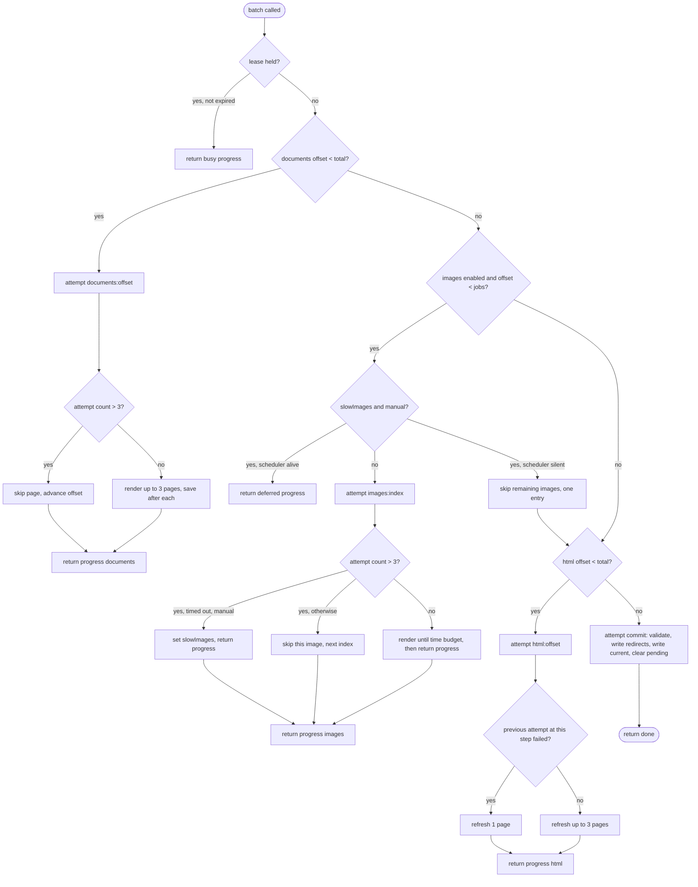
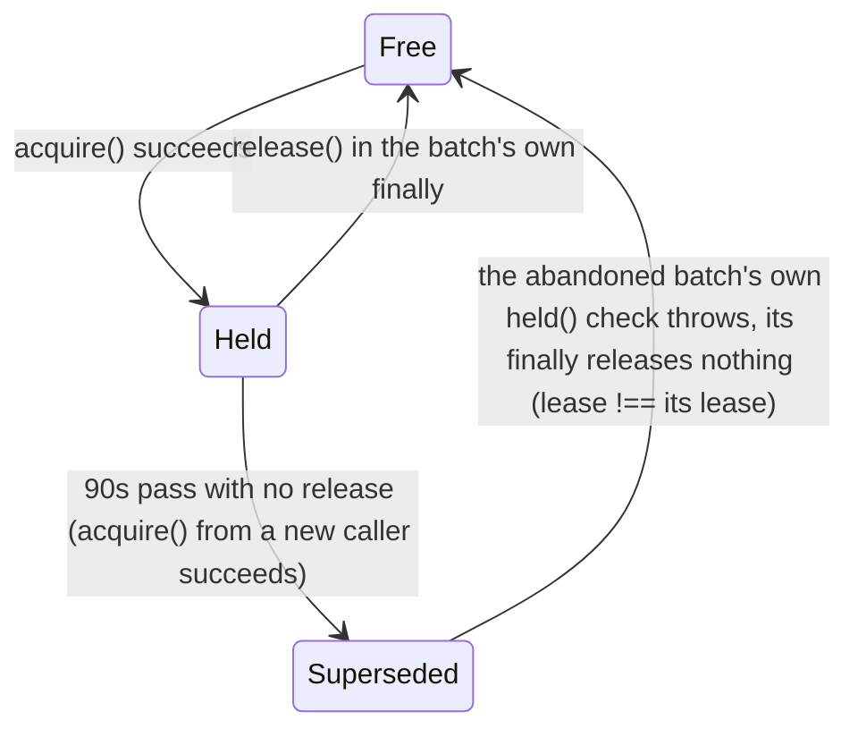
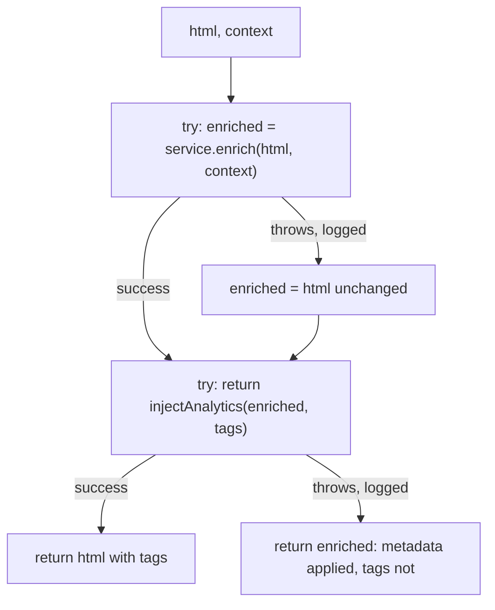
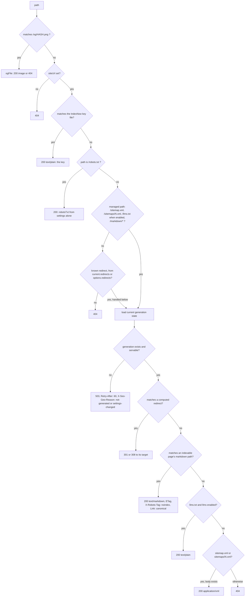
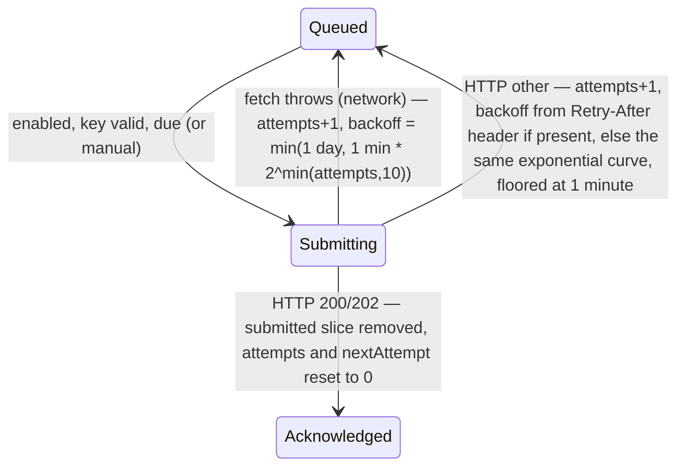
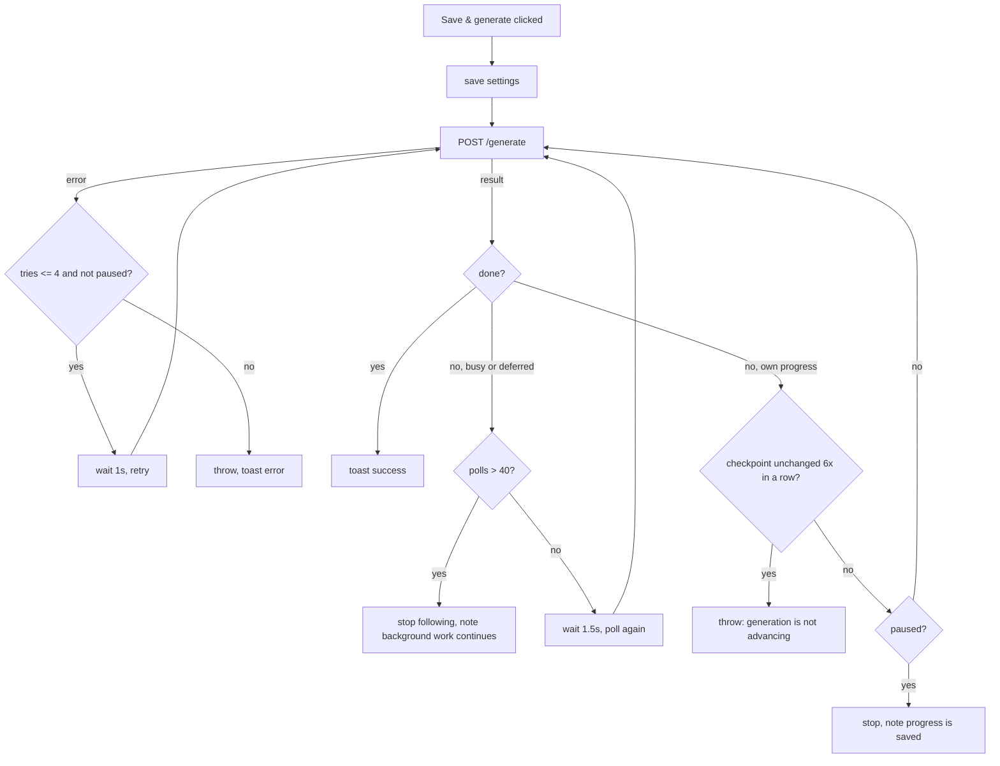
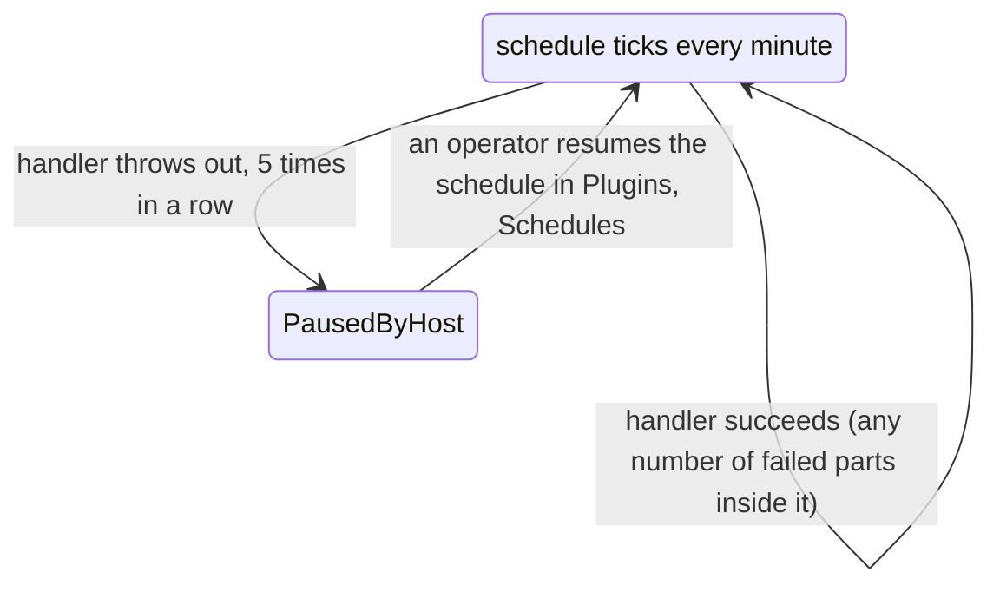

# State machines

This is how the plugin decides what to do and what to serve. It describes the code as it stands; `src/lifecycle.ts` and `src/service.ts` are the source of truth, and this document explains what they store and why.

## 1. Generation lifecycle

`deriveLifecycle` (`src/lifecycle.ts`) turns the stored records into one state. Nothing else computes it: `/status`, the admin banner and any agent reading the plugin all see the same answer.

### States

| `lifecycle.state`  | Stored records                                                    | Visitors and crawlers get                                   | Admin shows                                                        |
| ------------------- | ------------------------------------------------------------------- | ------------------------------------------------------------- | -------------------------------------------------------------------- |
| `unconfigured`      | no `siteUrl` setting                                                | 404 for every discovery URL (`/robots.txt` still answers)     | "Not set up" banner, next action `configure`                        |
| `never-generated`   | `siteUrl` set, no `current` record, no matching `pending`           | 503 with `X-Seo-Geo-Reason: not-generated`                    | "Not generated yet", next action `generate`                         |
| `generating`        | a `pending` record whose revision and configuration match the live settings | the previous `current` generation, if any and servable | "Generating", current phase and progress, next action `wait`        |
| `outdated`          | `current` exists but its configuration or publication revision no longer matches live, or a `pending` exists that does not match | the stale `current` generation, if servable | "Update waiting", next action `generate`                            |
| `ready`             | `current.configuration` matches live `configuration` **and** `current.revision` matches the live publication revision | the current generation's exports | "Up to date", next action `none`                                    |

`serving` is a separate flag, always one of `exports` or `nothing`: the site is configured and the committed generation is **servable** under the settings saved now (see below). A site can be `outdated` while still `serving: exports` — the old generation keeps answering while a new one builds.

### The two fingerprints

`fingerprints()` computes two hashes of the current settings:

- **`exports`** — only `{ format: 2, origin, options, llms }`. These are the only settings that change what the sitemap, Markdown and `llms.txt` actually contain.
- **`configuration`** — `exports` plus `analytics` (if any tags are set) and `ogTemplate` (if the social image design is enabled). These two change published HTML, but not the exports themselves.

A generation stores both (`Generation.exports`, `Generation.configuration`). `servable(generation, live)` decides whether its exports may still be served:

```
generation.exports !== undefined
  ? generation.exports === live.exports
  : generation.configuration === live.configuration || generation.configuration === live.exports
```

The fallback branch covers generations written before the split: when no analytics tags and no social-image design were ever set, `configuration` and `exports` were (and still are) the same string, so an old record is still recognised as servable. A **new** generation always carries `exports`, so it uses the strict check: only the four export-affecting settings matter.

Practically: saving analytics tags or changing the social image design changes `configuration` but not `exports`, so `servable` stays true and the sitemap/Markdown/`llms.txt` keep serving the previous generation while the affected pages' HTML is refreshed underneath them. Saving `siteUrl`, `options` (which pages, redirects, languages, crawler rules…) or toggling `llmsEnabled` changes `exports`, so the generation stops being servable immediately and `/sitemap.xml` and friends 503 until a new one commits. `fresh` is stricter still — it requires the *whole* `configuration` fingerprint and the publication revision to match — and decides `ready` vs `outdated`.

### Transitions

```mermaid
stateDiagram-v2
    [*] --> Unconfigured
    Unconfigured --> NeverGenerated: siteUrl saved
    NeverGenerated --> Generating: Save & generate, or the schedule's own tick
    Outdated --> Generating: Save & generate, or the schedule's own tick
    Generating --> Ready: batch reaches commit; configuration and revision match live
    Generating --> Outdated: settings saved or content republished while the batch is still running
    Ready --> Outdated: a setting is saved, or a published page changes revision
    Outdated --> Outdated: exports keep serving the old generation when only analytics/social-image settings changed
```



### Failure policy

- `lastError` is the error of the step currently being attempted (`pending.attempt`), cleared the moment that step succeeds (`advance()`). It is not a history: only the most recent failure of the *current* step is kept.
- `attention.code = "generation-failing"` once `lastError.attempts >= MAX_ATTEMPTS` (3). Next action becomes `fix-error`: fix the reported problem and generate again. The last good sitemap and exports stay online while this is true.
- `attention.code = "automation-silent"` when the state is not `ready` and no scheduled run has been seen for `AUTOMATION_SILENT_MS` (15 minutes). Next action becomes `resume-schedule`: generate now, then reopen the schedule (see §8).
- `attention.code = "pages-skipped"` is informational only — it never changes `nextAction` — and summarises `skipped` entries from the last run (pages left out of exports, images that kept the page's own image, or redirects that were reset).
- Only one `attention` is shown at a time, in that priority order.

## 2. One generation batch

`PublicationService.batch()` runs one step (or part of a step) per call and returns a `Progress`. Callers (the admin loop, or the schedule handler) call it again until `done`. The pipeline is always:

```
documents → images → html → commit
```



### Attempt counting and the skip policy

Every step records an `Attempt { step, count, error?, at? }` **before** it runs, via `attempt()`. If the host kills the call mid-step (the 5-second synchronous-call limit, or a thrown error), the next call sees the same `pending.attempt.step` and increments `count` instead of starting fresh — this is how a step that silently dies gets noticed. A step that finishes successfully calls `advance()`, which resets the count for the *next* step to 0.

| Step        | Skipped after `MAX_ATTEMPTS` (3)? | What happens instead                                                                        |
| ----------- | ---------------------------------- | --------------------------------------------------------------------------------------------- |
| `documents` | Yes                                 | The page is left out of this generation's exports; recorded in `skipped` as a `documents` entry and surfaced as `generation.page-skipped` (error severity). |
| `images`    | Yes                                 | The page keeps its own `og:image`; recorded as an `images` entry and surfaced as `generation.image-skipped` (warning).                                      |
| `html`      | Never                               | Retried forever, one page at a time once the first attempt at an offset fails (`size = 1` instead of `3`).                                                  |
| `commit`    | Never                               | Retried forever; nothing is skippable at commit — a cycle in redirects drops the remembered automatic redirects instead (a `redirects` skip entry), not a page. |

### Images: fast path, slow path, deferral

Rendering a social image calls `fflate`'s `zlibSync` inside QuickJS, which is the one step that has been seen to exceed the host's 5-second synchronous-call budget on a loaded server. The service adapts instead of failing the whole batch:

1. Normal encoding uses `PNG_LEVEL` (6).
2. If an image step has already failed once at the same offset, the rest of this run uses `PNG_FAST_LEVEL` (1) (`pending.fastImages`).
3. If even the fast path times out three times on a **manual** request, `pending.slowImages` is set. From then on, manual requests check `scheduleAlive()` (a scheduled run seen within `HEARTBEAT_MS + 2 minutes`): if it's alive, they return `{ phase: "images", deferred: true }` and let the background job finish the images; if it isn't, the remaining images are skipped with one explanatory entry and generation continues to `html`.
4. Inside the render loop itself, each image's duration is used to predict whether the *next* one would cross `IMAGE_BUDGET_MS` (3000 ms) before the request's own limit; the loop returns progress rather than risk the host killing it mid-render.

Manual (browser) requests get roughly 5 seconds per call; the scheduled job registers `maxDurationMs: 300000` with the host and gives itself a 45-second working deadline per run (see §8) — long enough to carry slow or deferred image work that a manual request cannot.

## 3. Batch lease



`acquire()` hands out a `Lease { since }` only when no lease is held, or the held one is more than `LEASE_MS` (90 seconds) old. A caller that cannot acquire one gets `busy()`'s saved progress (`{ done: false, busy: true, ...pending }`) instead of an error or a wait — this is what lets two admin tabs, or an admin tab and the schedule, point at the same run without colliding.

Every write inside `batch()` that follows an `await` back into host/network calls is preceded by `this.held(lease)`, which throws "This generation batch was replaced by a newer one" if the lease has since been taken over. This is the takeover guard: once a lease is 90 seconds old and a second caller acquires a new one, the first caller's remaining writes become no-ops (they throw before writing, since all writes to storage are themselves `await`s). `release()` only clears `this.lease` when it still points at the caller's own lease, so a superseded batch's `finally` cannot clear the new holder's lease either.

## 4. The `publish.html` filter

`server/index.ts` registers one `publish.html` filter. The host runs it on every published page and **discards the filter's entire result if it throws** — so the handler isolates its two jobs:



| Outcome                               | Result                                                                      |
| -------------------------------------- | ---------------------------------------------------------------------------- |
| Both succeed                            | Canonical/robots/JSON-LD/Markdown-link metadata **and** analytics tags applied |
| `enrich` throws                         | Original HTML is kept; `injectAnalytics` still runs on it, so tags can still be added to an otherwise-unenriched page |
| `injectAnalytics` throws                | Enriched metadata is kept; tags are left out of that page                   |
| Both throw                              | Original HTML returned unchanged; nothing is lost beyond the two features    |

Both failures are logged with `describeError` (name + message + stack — see §AGENTS.md) and tagged with the page's path, but never re-thrown. A page's metadata and a page's tracking tags are independent failure domains.

## 5. `publicFile` decision ladder

`PublicationService.publicFile(path)` answers every request under `cms.routes.site.get("/*")`. It is ordered so that the cheapest, generation-independent answers come first:



### Status codes and `X-Seo-Geo-Reason`

| Status | When                                                                 | Headers                                                            |
| ------ | ---------------------------------------------------------------------- | --------------------------------------------------------------------- |
| 200    | Image, key file, `robots.txt`, Markdown page, `llms.txt`, sitemap/sitemap index served | Content-specific `Content-Type`; discovery responses add `Cache-Control: no-store` |
| 301/308 | A configured or stable-ID redirect resolves for this path                | `Location`                                                           |
| 404    | No `siteUrl`, an unmanaged/unknown path with no matching redirect, or a managed path whose content doesn't exist | `Cache-Control: no-store`                                            |
| 503    | A managed path is requested but there is no servable generation         | `Retry-After: 60`, `X-Seo-Geo-Reason: not-generated` (nothing has ever committed) or `settings-changed` (a generation exists but `servable` is false) |

`robots.txt` is built straight from settings (`configuration()` + `robotsTxt()`) and never touches generation state, so it answers even while the site is `unconfigured`-adjacent or mid-rebuild. Every other managed path is checked against the live `current` record and the live fingerprints on every request — `no-store` is set deliberately so a browser or CDN never caches a stale 503 or a stale sitemap past the next retraction.

## 6. IndexNow queue and backoff

State key `indexnow-queue`: `{ urls: string[], attempts: number, nextAttempt: number }`.

- **Enqueue** happens only at commit (`batch()`'s commit step), diffing the new generation's pages against the previous (`earlier`) ones: a newly indexable page, or one whose `contentHash` changed, is added; a page that was indexable and no longer is gets queued too (so removal is announced). The set is deduplicated (`new Set([...])`).
- **Submit** (`submitIndexNow`) is wrapped in `service.serializeIndexNow`, which chains calls on a shared tail promise so a commit's queue write and a submission's read/acknowledge never interleave. An operation that has held its turn for more than `LEASE_MS` (90 seconds) is treated as abandoned by the sandbox, and newcomers stop waiting for it; one that is only queued does not count as running.
- Gating: `indexNowEnabled` must be true and `indexNowKey` must match `/^[a-zA-Z0-9-]{8,128}$/`. Queued URLs are filtered to the configured origin before anything is sent, so a stale entry from a changed `siteUrl` is dropped silently rather than submitted.
- A scheduled call (`manual = false`) does nothing while `nextAttempt` is still in the future; the admin's **Retry** button passes `manual = true` and submits immediately regardless.
- Each submission sends at most 10,000 URLs (`batch = urls.slice(0, 10000)`); the rest stay queued for the next run.



HTTP 200/202 means the batch was received and schema-validated by IndexNow, never that any search engine has indexed or will index the URLs.

## 7. Admin "Save & generate" loop

`admin/index.tsx`'s `generate()` saves settings, then drives `/generate` to completion:

1. `batch()` posts `{"client":2}` to `/generate`. The marker tells the server this page understands `busy` and `deferred` results; a tab opened before an upgrade sends `{}` and gets the plain error its older loop expects instead. Then, on a thrown error it retries up to 4 times with a 1-second wait between attempts (unless paused), surfacing "A step failed and is being retried (N of 4)" — this is a client-side retry around transport/5xx failures, independent of the server's own per-step attempt counter.
2. While the result is `busy` (another lease holder is running) or `deferred` (images handed to the schedule), the loop polls again after 1.5 s and shows that caller's progress instead of failing. After `BUSY_POLLS` (40) polls (~60 s) with no progress of its own, it gives up following and tells the user generation continues in the background.
3. Otherwise it builds a checkpoint string (`phase:offset:refreshed:images`). An unchanged checkpoint across calls increments a `stalled` counter; past 6 unchanged calls in a row it throws "Generation is not advancing" (the server itself does make progress on retries by skipping bad pages/images, so six genuinely identical results means something outside the normal skip policy is wrong).
4. The **Pause foreground generation** button only sets a ref flag checked between iterations; it stops this tab from posting again but does not cancel a request already in flight, and does not touch the server lease or the scheduled job.
5. Separately, whenever `status.lifecycle.state` is `generating` or `outdated` and this tab isn't the one driving a batch, a 10-second interval (only while the tab is visible) re-fetches `/status`, so the banner never says "not generated" while a schedule tick or another tab is doing the work.



## 8. Background automation heartbeat and the schedule

State key `automation`: `{ since: number, scheduledAt?: number }`. `since` is set once, the first time any batch ever ran for this plugin install; `scheduledAt` is updated only by `heartbeat("schedule")`, and only after `HEARTBEAT_MS` (5 minutes) have passed since the last update — so a schedule ticking every minute writes roughly once every 5.

`server/index.ts` registers the schedule as:

```
id: "publication-sync", cadence: every 1 minute, overlap: "skip", maxDurationMs: 300000
```

Each run:

1. `heartbeat("schedule")` — independent of everything else below, so a later failure still proves the schedule itself is alive.
2. If `siteUrl` isn't set, stop here.
3. Call `rebuild(false, "schedule")` repeatedly until it's `done`, `busy` (another run or an admin tab holds the lease), or a 45-second working deadline passes — well inside the host's 300-second `maxDurationMs`, leaving headroom for the admin page to take a turn.
4. Only if that finished `done`: record today's health snapshot, submit the IndexNow queue, and run cleanup (`cleanup()` removes superseded documents, unused social images, and stale logos).

Each of the four parts (`heartbeat`, `generation`, `health snapshot`/`IndexNow`/`cleanup`) is wrapped individually so one failing part cannot take the others down with it, logged through `describeError`.

`lifecycle.automation.silent` becomes true when `now - max(scheduledAt, since) > AUTOMATION_SILENT_MS` (15 minutes) and an `automation` record exists at all. This is the only way the plugin notices the schedule has stopped — the handler itself cannot know it isn't being called.

**The host auto-pauses a schedule after 5 consecutive failed handler runs, and only an operator can resume it; the plugin cannot resume it from inside the sandbox.** When `attention.code` is `automation-silent`, the recommended next action tells you where: generate once by hand, then open **Instatic admin → Plugins → SEO, GEO & AIO → Schedules** and resume **`publication-sync`**.


